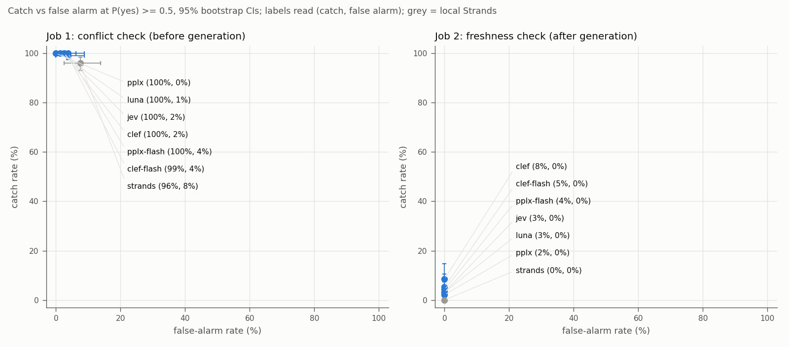
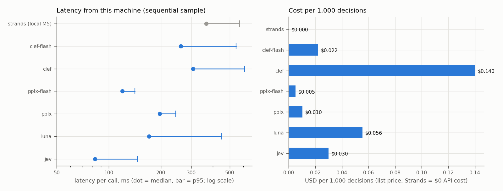
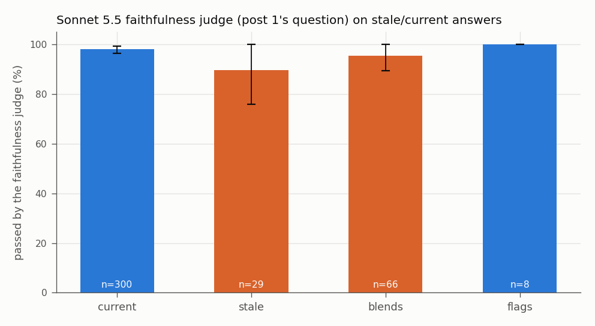
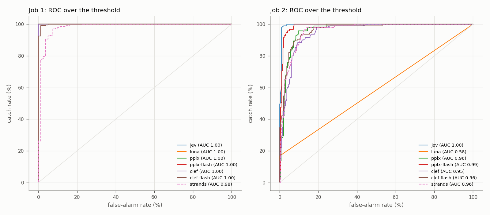

# Post 3: can the new decision models catch stale RAG answers?

Regenerated by `freshness/analyze.py`; not hand-edited (findings come from `freshness/findings.md`).

## Top findings

1. **Before generation, the conflict check works.** On the 101 stale/current items, the six hosted decision models
   catch 99–100% of the conflicts (n=202 per model) and raise a false alarm on 0–4% of the agreeing controls (n=80).
   Strands, running locally, catches 96% with 8% false alarms. On real WikiContradict pairs, catch falls to 52–72% for
   the hosted models and 15% for Strands (n=40). It's cheap and quick: Perplexity's flash model costs $0.005 per 1,000
   decisions at a 120 ms median, and Jev is fastest at 83 ms. Asking the same request twice almost never changed a
   verdict (0–1%).

2. **After generation, nothing catches the stale answer.** At P(yes) ≥ 0.5, the seven decision models catch 0–8% of
   the 95 stale or blended answers. The Sonnet 5.5 faithfulness judge from post 1 passes 94% of them, including 26 of the
   27 the human labeled stale. Nearly all of these answers come from Gemma 4 31B (94 of 95). Claude Haiku 5.5 gave
   the newer value in 193 of its 202 stale/current answers and flagged the conflict in 7 more.

3. **The good-looking Job 2 ROC is mostly a shortcut, and the "future change" answer fools most models.** Across all
   answers, Job 2 AUC is 0.95–1.00 (Luna 0.58), but stale answers mention the old value and current ones mostly don't.
   Within the 107 human-labeled timeline answers, where every answer mentions both values, AUC falls to 0.57–0.92 (only
   8 of them are current). Between stale answers (the newer value presented as a future change) and blended ones, four
   models — Jev, Perplexity Flash, Clef, Clef-flash — score the stale answers as *fresher* (AUC 0.26–0.39). The LLM
   labelers fell for the same shape: on the 107 timeline answers they agreed with the human on 54 (Sonnet) and 58
   (Sol), and called 0 and 4 of them stale. The human called 27 of them stale.

**Harness bugs and run notes**

- **The ledger recorded batch spend only when a step closed.** The first full-run process stopped while waiting on
  OpenAI's batch, and the cost of Sonnet's finished label batch ($0.52) was never recorded. I priced it from
  Anthropic's usage numbers and added it to the ledger by hand. Fix: record each batch's spend as soon as it ends.
- **The polling process belonged to the Claude session.** It ended with that session. The rerun resumed both batches
  by their saved ids, and nothing was paid twice.
- **Cloudflare's free-plan limit wasn't checked.** The estimate showed list prices but never compared them against the
  account's 10,000-neuron daily free allocation. Job 1 and Job 2 used about 12,300 neurons; Cloudflare let the overrun
  through, then answered every later call with 429 (code 4006). The client treated that as a retryable rate limit,
  and the noise and latency calls waited a day and a plan upgrade. Fix: treat 4006 as fatal and check the plan's limit
  at estimate time.
- **Perplexity rate limits:** 63 (v1.2) and 233 (flash) decisions needed a retry after a 429. They are excluded from
  latency, which came from a separate sequential sample with no retries.
- **The pilot and the full run shared a latency cache tag.** One sampled call per model was already cached, so each
  model has 99 timed calls instead of 100.
- **Analysis fixes made before reading the headline numbers:** latency had counted that cached call, H3 named a
  "lowest" date format when all three were tied, and two within-timeline AUC rows were added to Job 2 once the
  shortcut showed up.

## Setup

Seven decision models were asked the same two yes/no questions with their native yes/no type, and read at P(yes) >= 0.5. Job 1 (before generation): *"Do these chunks give different answers to the question?"* Job 2 (after generation): *"Does this answer use the most recent source in the context?"* on answers written by Claude Haiku 5.5 and Gemma 4 31B with LangChain's default RAG prompt. Every item ran twice: newer chunk first and older chunk first. Design, data, model IDs and prices: README.md.

Not reachable: **Microsoft-Decision-1** (Azure AI Foundry, preview. The user's deployment failed with 'quota exceeded' in every region (2026-10-24); weights are not published. Substitute: pplx-decider-flash-v1.2.)

Spend for the whole post: $2.2449 of the $5 cap (ledger).

Job 2 truth counts (kind | truth source | truth): conflict|human|fresh 8, conflict|human|left out 8, conflict|human|stale/blends 91, conflict|labelers|fresh 292, conflict|labelers|stale/blends 4, conflict|split|left out 1, control|labelers|fresh 160

## Job 1: conflict check

| Model | Catch (stale/current) | False alarm (controls) | AUC | Catch, newer first | Catch, older first | Catch, WikiContradict |
|---|---|---|---|---|---|---|
| jev | 100% [100, 100] (n=202) | 2% [0, 6] (n=80) | 1.00 [1.00, 1.00] | 100% [100, 100] (n=101) | 100% [100, 100] (n=101) | 72% [57, 85] (n=40) |
| luna | 100% [100, 100] (n=202) | 1% [0, 4] (n=80) | 1.00 [1.00, 1.00] | 100% [100, 100] (n=101) | 100% [100, 100] (n=101) | 68% [52, 82] (n=40) |
| pplx | 100% [100, 100] (n=202) | 0% [0, 0] (n=80) | 1.00 [1.00, 1.00] | 100% [100, 100] (n=101) | 100% [100, 100] (n=101) | 72% [57, 85] (n=40) |
| pplx-flash | 100% [100, 100] (n=202) | 4% [0, 9] (n=80) | 1.00 [1.00, 1.00] | 100% [100, 100] (n=101) | 100% [100, 100] (n=101) | 62% [48, 78] (n=40) |
| clef | 100% [100, 100] (n=202) | 2% [0, 6] (n=80) | 1.00 [1.00, 1.00] | 100% [100, 100] (n=101) | 100% [100, 100] (n=101) | 72% [57, 85] (n=40) |
| clef-flash | 99% [98, 100] (n=202) | 4% [0, 9] (n=80) | 1.00 [1.00, 1.00] | 99% [97, 100] (n=101) | 99% [97, 100] (n=101) | 52% [38, 68] (n=40) |
| strands | 96% [93, 99] (n=202) | 8% [2, 14] (n=80) | 0.98 [0.96, 1.00] | 96% [92, 99] (n=101) | 96% [92, 99] (n=101) | 15% [5, 28] (n=40) |

By date format (catch on stale/current items):

| Model | Header | Body | Version only |
|---|---|---|---|
| jev | 100% [100, 100] (n=68) | 100% [100, 100] (n=68) | 100% [100, 100] (n=66) |
| luna | 100% [100, 100] (n=68) | 100% [100, 100] (n=68) | 100% [100, 100] (n=66) |
| pplx | 100% [100, 100] (n=68) | 100% [100, 100] (n=68) | 100% [100, 100] (n=66) |
| pplx-flash | 100% [100, 100] (n=68) | 100% [100, 100] (n=68) | 100% [100, 100] (n=66) |
| clef | 100% [100, 100] (n=68) | 100% [100, 100] (n=68) | 100% [100, 100] (n=66) |
| clef-flash | 99% [96, 100] (n=68) | 99% [96, 100] (n=68) | 100% [100, 100] (n=66) |
| strands | 91% [84, 97] (n=68) | 97% [93, 100] (n=68) | 100% [100, 100] (n=66) |

## Job 2: freshness check

A model catches a stale answer by saying **no**. Headline truth: the human's label for timeline answers, the labelers' agreed label elsewhere.

| Model | Catch (stale/blends) | False alarm (current) | AUC | Catch, timeline answers | Catch, other answers | False alarm, controls |
|---|---|---|---|---|---|---|
| jev | 3% [0, 7] (n=95) | 0% [0, 0] (n=300) | 1.00 [0.99, 1.00] | 1% [0, 3] (n=91) | 50% [0, 100] (n=4) | 0% [0, 0] (n=160) |
| luna | 3% [0, 7] (n=95) | 0% [0, 0] (n=300) | 0.58 [0.55, 0.62] | 0% [0, 0] (n=91) | 75% [25, 100] (n=4) | 0% [0, 0] (n=160) |
| pplx | 2% [0, 5] (n=95) | 0% [0, 0] (n=300) | 0.96 [0.95, 0.98] | 0% [0, 0] (n=91) | 50% [0, 100] (n=4) | 0% [0, 0] (n=160) |
| pplx-flash | 4% [1, 8] (n=95) | 0% [0, 0] (n=300) | 0.99 [0.98, 1.00] | 2% [0, 5] (n=91) | 50% [0, 100] (n=4) | 0% [0, 0] (n=160) |
| clef | 8% [3, 15] (n=95) | 0% [0, 0] (n=300) | 0.95 [0.93, 0.97] | 5% [1, 10] (n=91) | 75% [25, 100] (n=4) | 1% [0, 2] (n=160) |
| clef-flash | 5% [1, 11] (n=95) | 0% [0, 0] (n=300) | 0.96 [0.94, 0.98] | 3% [0, 8] (n=91) | 50% [0, 100] (n=4) | 19% [13, 26] (n=160) |
| strands | 0% [0, 0] (n=95) | 0% [0, 0] (n=300) | 0.96 [0.94, 0.98] | 0% [0, 0] (n=91) | 0% [0, 0] (n=4) | 0% [0, 0] (n=160) |

Sensitivity, the labelers' agreed truth everywhere (timeline answers included):

| Model | Catch | False alarm |
|---|---|---|
| jev | 5% [0, 12] (n=42) | 0% [0, 0] (n=311) |
| luna | 7% [0, 17] (n=42) | 0% [0, 0] (n=311) |
| pplx | 5% [0, 12] (n=42) | 0% [0, 0] (n=311) |
| pplx-flash | 7% [0, 17] (n=42) | 0% [0, 0] (n=311) |
| clef | 14% [5, 26] (n=42) | 0% [0, 0] (n=311) |
| clef-flash | 10% [2, 19] (n=42) | 0% [0, 0] (n=311) |
| strands | 0% [0, 0] (n=42) | 0% [0, 0] (n=311) |

Post hoc (added after seeing the full-run numbers): AUC within the human-labeled timeline answers only, where every answer mentions both values, so a model can't separate them by "mentions the old value". Human truth: {'blends': 64, 'stale': 27, 'flags': 8, 'current': 8}

| Model | AUC, stale/blends vs current | AUC, stale vs blends |
|---|---|---|
| jev | 0.88 [0.71, 1.00] | 0.39 [0.26, 0.50] |
| luna | 0.57 [0.53, 0.60] | 0.57 [0.48, 0.66] |
| pplx | 0.85 [0.69, 0.98] | 0.60 [0.46, 0.72] |
| pplx-flash | 0.92 [0.84, 0.99] | 0.26 [0.16, 0.38] |
| clef | 0.86 [0.75, 0.96] | 0.28 [0.16, 0.41] |
| clef-flash | 0.85 [0.69, 0.98] | 0.37 [0.26, 0.50] |
| strands | 0.70 [0.50, 0.90] | 0.67 [0.54, 0.79] |

Splits (catch rate):

| Model | Newer first | Older first | Header | Body | Version only | Haiku 5.5 answers | Gemma answers |
|---|---|---|---|---|---|---|---|
| jev | 2% [0, 7] (n=43) | 4% [0, 10] (n=52) | 8% [0, 19] (n=26) | 0% [0, 0] (n=47) | 5% [0, 14] (n=22) | 0% [0, 0] (n=1) | 3% [0, 7] (n=94) |
| luna | 5% [0, 12] (n=43) | 2% [0, 6] (n=52) | 12% [0, 23] (n=26) | 0% [0, 0] (n=47) | 0% [0, 0] (n=22) | 0% [0, 0] (n=1) | 3% [0, 7] (n=94) |
| pplx | 2% [0, 7] (n=43) | 2% [0, 6] (n=52) | 8% [0, 19] (n=26) | 0% [0, 0] (n=47) | 0% [0, 0] (n=22) | 0% [0, 0] (n=1) | 2% [0, 5] (n=94) |
| pplx-flash | 5% [0, 12] (n=43) | 4% [0, 10] (n=52) | 12% [0, 27] (n=26) | 0% [0, 0] (n=47) | 5% [0, 14] (n=22) | 0% [0, 0] (n=1) | 4% [1, 9] (n=94) |
| clef | 7% [0, 14] (n=43) | 10% [2, 17] (n=52) | 12% [0, 23] (n=26) | 0% [0, 0] (n=47) | 23% [9, 41] (n=22) | 0% [0, 0] (n=1) | 9% [3, 15] (n=94) |
| clef-flash | 5% [0, 12] (n=43) | 6% [0, 13] (n=52) | 12% [0, 27] (n=26) | 0% [0, 0] (n=47) | 9% [0, 23] (n=22) | 0% [0, 0] (n=1) | 5% [1, 11] (n=94) |
| strands | 0% [0, 0] (n=43) | 0% [0, 0] (n=52) | 0% [0, 0] (n=26) | 0% [0, 0] (n=47) | 0% [0, 0] (n=22) | 0% [0, 0] (n=1) | 0% [0, 0] (n=94) |

## Faithfulness baseline (Sonnet 5.5, post 1's question)

| Answer label | Passed |
|---|---|
| blends | 95% [89, 100] (n=66) |
| current | 98% [96, 99] (n=300) |
| flags | 100% [100, 100] (n=8) |
| stale | 90% [76, 100] (n=29) |
| stale_or_blends | 94% [88, 98] (n=95) |

## Latency and cost

Measured from this machine: 100 sequential Job 1 calls per model after 5 warm-up calls, no automatic retries. Strands is local and kept apart.

| Model | Where | Median ms | p95 ms | n | Vendor claim | Cost per 1,000 decisions |
|---|---|---|---|---|---|---|
| jev | hosted, from this machine | 83 | 146 | 99 | none published (docs.typesafe.ai/models, checked 2026-10-24) | $0.0300 |
| luna | hosted, from this machine | 171 | 446 | 99 | none on the docs page; launch coverage quotes 'about 10x faster than the Responses API' | $0.0555 |
| pplx | hosted, from this machine | 197 | 244 | 99 | 'a few hundred input tokens took under 2 seconds' (quickstart, tests of 2026-09-30, earlier model) | $0.0104 |
| pplx-flash | hosted, from this machine | 120 | 141 | 99 | none for short inputs (quickstart gives 16 s for ~248k input tokens) | $0.0052 |
| clef | hosted, from this machine | 307 | 610 | 99 | median 209.3 ms, p95 238.6 ms over 43 benchmarks (Cloudflare blog; setup not stated) | $0.1400 |
| clef-flash | hosted, from this machine | 261 | 545 | 99 | median 38.8 ms, p95 122.4 ms over 43 benchmarks (Cloudflare blog; setup not stated) | $0.0222 |
| strands | local M5 | 366 | 569 | 99 | RTX 3090, vendor-measured, not verified here: median 115 ms, p95 299 ms per JevBench question (checkpoint v19, evaluation/results.md) | $0.0000 |

## Noise (the same request twice)

| Job | Model | Verdict changed | Mean abs. change in P(yes) |
|---|---|---|---|
| job1 | jev | 0% [0, 0] (n=80) | 0.0055 |
| job1 | luna | 0% [0, 0] (n=80) | 0.0 |
| job1 | pplx | 0% [0, 0] (n=80) | 0.0 |
| job1 | pplx-flash | 0% [0, 0] (n=80) | 0.0 |
| job1 | clef | 0% [0, 0] (n=80) | 0.0 |
| job1 | clef-flash | 0% [0, 0] (n=80) | 0.0 |
| job1 | strands | 0% [0, 0] (n=80) | 0.0 |
| job2 | jev | 1% [0, 3] (n=160) | 0.0097 |
| job2 | luna | 0% [0, 0] (n=160) | 0.0 |
| job2 | pplx | 0% [0, 0] (n=160) | 0.0 |
| job2 | pplx-flash | 0% [0, 0] (n=160) | 0.0 |
| job2 | clef | 0% [0, 0] (n=160) | 0.0 |
| job2 | clef-flash | 0% [0, 0] (n=160) | 0.0 |
| job2 | strands | 0% [0, 0] (n=160) | 0.0 |

## Generators: answer mix

Final label per answer (human for timeline answers).

| Generator \| kind \| split | Labels |
|---|---|
| gemma|conflict|body | blends 29, current 21, stale 18 |
| gemma|conflict|header | current 42, blends 15, stale 11 |
| gemma|conflict|new_first | current 59, blends 29, stale 13 |
| gemma|conflict|old_first | current 48, blends 36, stale 16, flags 1 |
| gemma|conflict|version | current 44, blends 21, flags 1 |
| gemma|control|new_first | current 40 |
| gemma|control|old_first | current 40 |
| gemma|wiki|new_first | flags 9, a 5, b 5, blends 1 |
| gemma|wiki|old_first | flags 9, a 7, b 4 |
| haiku55|conflict|body | current 67, flags 1 |
| haiku55|conflict|header | current 64, flags 3, split 1 |
| haiku55|conflict|new_first | current 97, flags 2, blends 1, split 1 |
| haiku55|conflict|old_first | current 96, flags 5 |
| haiku55|conflict|version | current 62, flags 3, blends 1 |
| haiku55|control|new_first | current 40 |
| haiku55|control|old_first | current 40 |
| haiku55|wiki|new_first | flags 12, b 5, a 2, split 1 |
| haiku55|wiki|old_first | flags 10, split 4, b 4, blends 1, a 1 |

## Labelers

All answers: label agreement 0.933 (kappa 0.842), conflict_noted 0.957, timeline 0.957 (n=644). Human vs labeler on timeline answers: {'sonnet': '54/107', 'sol': '58/107'}.

## Hypotheses

```
{
 "H1 faithfulness judge passes most stale answers": {
  "pass_rate_on_stale_or_blends": {
   "n": 95,
   "k": 89,
   "ci": [
    0.9368421052631579,
    0.8842105263157894,
    0.9789473684210527
   ]
  },
  "supported": true
 },
 "H2 decision models catch conflicts more often than stale answers": {
  "jev": {
   "job1_catch": 1.0,
   "job2_catch": 0.031578947368421054,
   "ci_separate": true
  },
  "luna": {
   "job1_catch": 1.0,
   "job2_catch": 0.031578947368421054,
   "ci_separate": true
  },
  "pplx": {
   "job1_catch": 1.0,
   "job2_catch": 0.021052631578947368,
   "ci_separate": true
  },
  "pplx-flash": {
   "job1_catch": 1.0,
   "job2_catch": 0.042105263157894736,
   "ci_separate": true
  },
  "clef": {
   "job1_catch": 1.0,
   "job2_catch": 0.08421052631578947,
   "ci_separate": true
  },
  "clef-flash": {
   "job1_catch": 0.9900990099009901,
   "job2_catch": 0.05263157894736842,
   "ci_separate": true
  },
  "strands": {
   "job1_catch": 0.9603960396039604,
   "job2_catch": 0.0,
   "ci_separate": true
  }
 },
 "H3 version-only dates are missed most": {
  "job1|jev": {
   "lowest": "tie: header, body, version",
   "header": 1.0,
   "body": 1.0,
   "version": 1.0
  },
  "job1|luna": {
   "lowest": "tie: header, body, version",
   "header": 1.0,
   "body": 1.0,
   "version": 1.0
  },
  "job1|pplx": {
   "lowest": "tie: header, body, version",
   "header": 1.0,
   "body": 1.0,
   "version": 1.0
  },
  "job1|pplx-flash": {
   "lowest": "tie: header, body, version",
   "header": 1.0,
   "body": 1.0,
   "version": 1.0
  },
  "job1|clef": {
   "lowest": "tie: header, body, version",
   "header": 1.0,
   "body": 1.0,
   "version": 1.0
  },
  "job1|clef-flash": {
   "lowest": "tie: header, body",
   "header": 0.985,
   "body": 0.985,
   "version": 1.0
  },
  "job1|strands": {
   "lowest": "header",
   "header": 0.912,
   "body": 0.971,
   "version": 1.0
  },
  "job2|jev": {
   "lowest": "body",
   "header": 0.077,
   "body": 0.0,
   "version": 0.045
  },
  "job2|luna": {
   "lowest": "tie: body, version",
   "header": 0.115,
   "body": 0.0,
   "version": 0.0
  },
  "job2|pplx": {
   "lowest": "tie: body, version",
   "header": 0.077,
   "body": 0.0,
   "version": 0.0
  },
  "job2|pplx-flash": {
   "lowest": "body",
   "header": 0.115,
   "body": 0.0,
   "version": 0.045
  },
  "job2|clef": {
   "lowest": "body",
   "header": 0.115,
   "body": 0.0,
   "version": 0.227
  },
  "job2|clef-flash": {
   "lowest": "body",
   "header": 0.115,
   "body": 0.0,
   "version": 0.091
  },
  "job2|strands": {
   "lowest": "tie: header, body, version",
   "header": 0.0,
   "body": 0.0,
   "version": 0.0
  }
 }
}
```

## Figures






## Limitations

- **Authored data.** The 101 stale/current items and 40 controls are fictional policy documents written by Claude
  Opus 5.5 (not tested here). They are clean by design (one changed value, dated versions next to each other); real
  knowledge bases are messier. WikiContradict (20 items) is the real-data check and is reported separately.
- **Few stale answers, one generator, one shape.** Job 2's catch rate rests on the 95 stale or blended answers the
  two generators happened to write: 94 from Gemma, 1 from Haiku 5.5. 91 of them are "timeline" answers (both values
  with their dates), and their truth comes from one human (the post's author) under a rule fixed before the full run.
- **Job 2's wording has a literal reading.** A timeline answer that treats the newer date as a future change does
  mention the most recent source, so a decision model can say "yes" to "Does this answer use the most recent
  source in the context?" and be literally right while the answer is stale.
- **Labels are model labels outside the timeline set.** Sonnet 5.5 and gpt-6.1-sol agreed with a human on 38 and 35
  of 40 pilot answers (all disagreements were timeline answers); the labelers-only truth is shown as a sensitivity
  row.
- **One threshold, one wording, default settings.** Every model gets the same question text with no criteria and is
  read at P(yes) >= 0.5; vendors' own phrasing or calibrated thresholds could change the ranking. The ROC/AUC columns
  show how much a different threshold would help, but Job 2's all-answers AUC is inflated by a shortcut (answers that
  mention the old value score lower); the within-timeline AUCs are the fairer test, and they rest on 8 current
  answers.
- **Latency is from one machine and one network**, on short inputs (about 1,000 tokens), 99 timed sequential calls per
  model (the 100th was already cached by the pilot and has no fresh timing); vendor figures were measured on other setups and are not comparable. Strands ran on an Apple M5 (MPS) and
  is not comparable with the hosted models or with AWS's RTX 3090 figure.
- **Model versions.** pplx-decider-v1.2 stands in for the v1 the task named (the API routes v1 to v1.2);
  pplx-decider-flash-v1.2 stands in for Microsoft-Decision-1, which was not reachable. Hosted models can change
  behind the same ID; the cache keeps the responses this report used.
- **Cloudflare ran on two days and two plans.** Clef and Clef-flash ran Job 1 and Job 2 on Cloudflare's free plan on
  2026-10-27 (UTC); their noise re-run and latency sample ran on Workers Paid on 2026-10-28. Costs everywhere are
  list prices; the free-plan calls were not actually billed.

## Harness checks

```
{
 "decision_status": {},
 "decisions_retried": {
  "pplx": 63,
  "pplx-flash": 233
 },
 "label_status": {
  "sol|ok": 644,
  "sonnet|ok": 644
 },
 "answers_ok": 644
}
```
