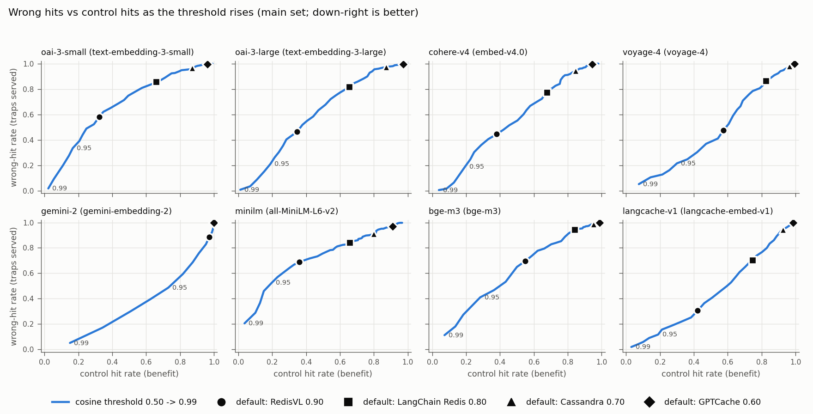
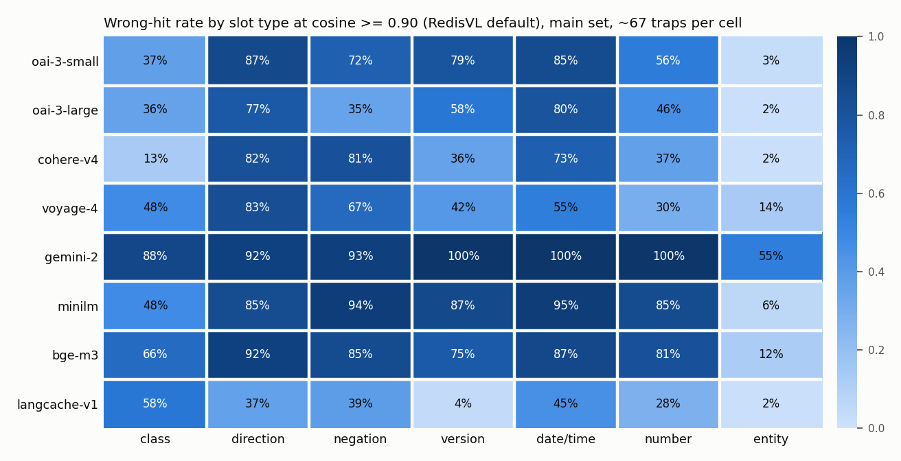

# Results: how often does a semantic cache serve the wrong stored answer?

Regenerated by `semcache/analyze.py`; not hand-edited (findings come from `semcache/findings.md`).

Main set: 409 traps (need a different answer) and 360 controls (need the same answer), authored 402, gpt-6.1-sol 184, claude-sonnet-5-5 183. PAWS: 150 / 150. 8 embedding models, deciders jev113 (`jev-1.13.0`), jev114 (`jev-1.14.0`), luna (`gpt-6-luna`).

## Top findings

1. **At RedisVL's default threshold (cosine 0.90), an embedding-only cache served 31-70% of the queries that needed a different answer on 7 of 8 models, and only 32-57% of the true paraphrases.** For 5 of 8 models, cosine scored the one-detail traps *above* real rewordings (AUC 0.29-0.45, CIs below 0.5); voyage-4 (0.54), the cache-tuned langcache-embed-v1 (0.56) and gemini-embedding-2 (0.67) beat chance. gemini-embedding-2 shows the other half of the problem: its scores sit on a higher scale, so at 0.90 it served 89% of traps and 97% of paraphrases - one default threshold does not carry across models. Swapped direction is the worst case (77-92% served on 7 of 8 models; 37% on langcache-v1); swapped brand or provider the mildest (2-14%, except 55% on gemini-embedding-2). Raising the threshold does not fix it: A1 (the highest threshold keeping 80% of control hits, chosen out of fold) blocked 7-33% of wrong hits while losing 9-17% of control hits. Library defaults at or below LangChain's 0.80 served 70-100% of traps. Searching a full cache (all 721 stored queries, nearest one served) instead of one stored query barely changed this: with 30 of the new matches labelled by hand, the wrong-hit rate moved by under 1 point on 7 of 8 models and fell 3 points on gemini-embedding-2, because a trap's nearest neighbour is almost always its own one-detail-different partner; right hits rose 1-3 points.
2. **A yes/no decision-model check on top (A3) blocked 93-99% of the wrong hits and gave up 0-5% of the control hits, for about $0.006-0.026 per 1,000 lookups.** Jev 1.13, Jev 1.14 and GPT-6 Luna were within noise of each other on traps (they accept 3.0-4.6% of the traps they see; CIs overlap); Jev 1.14 turned away slightly more paraphrases (5.4% vs 2.0-3.4%; intervals overlap). It is not a complete fix: on PAWS word-swap pairs (where "Missouri ... America" becomes "America ... Missouri"), the deciders still let 21-25% of non-paraphrases through and turned away 4-10% of real paraphrases.
3. **The rule-based slot guard (A2) looked much better on its own author's data.** On its own it caught 92% [88, 96] of traps on the pairs written by the same author (Claude Opus 5.5, before the pairs existed), but 71% [62, 81] on pairs written by gpt-6.1-sol and Claude Sonnet 5.5, and missed most direction traps (37% caught overall). It also blocked 14% of controls: 40% of number-format changes and 20% of other format aliases. On PAWS it blocked 5-6% of wrong hits. Hypotheses: direction traps did score above 0.95 on most models (7 of 8 medians 0.956-0.996; langcache-v1 0.875); negation traps did not (only all-MiniLM-L6-v2 and BGE-M3 had medians above 0.95). The guard did block most traps and did lose hits on aliases, but how many it blocks depends on who wrote the traps.

## Library defaults applied to each model (main set)

Wrong-hit rate / control hit rate at each library's default threshold, converted to cosine. OpenSearch's default passes every pair (100% / 100%) and SingleStore's 0.20 almost every pair.

| Model | RedisVL (0.90) | LangChain Redis, both packages (0.80) | Cassandra (0.70) | GPTCache (0.60) |
|---|---|---|---|---|
| oai-3-small | 58% / 32% | 86% / 66% | 97% / 87% | 100% / 96% |
| oai-3-large | 46% / 35% | 82% / 66% | 97% / 87% | 100% / 97% |
| cohere-v4 | 44% / 38% | 78% / 68% | 95% / 85% | 100% / 94% |
| voyage-4 | 48% / 57% | 86% / 82% | 98% / 96% | 100% / 99% |
| gemini-2 | 89% / 97% | 100% / 100% | 100% / 100% | 100% / 100% |
| minilm | 69% / 36% | 84% / 66% | 91% / 80% | 97% / 91% |
| bge-m3 | 70% / 55% | 94% / 84% | 99% / 95% | 100% / 99% |
| langcache-v1 | 31% / 42% | 70% / 75% | 94% / 92% | 100% / 99% |

n = 409 traps, 360 controls per cell; 95% CIs in `results/metrics_full.json`.

## A0 at the RedisVL default (cosine >= 0.90)

AUC = chance that a random control (same answer) scores higher than a random trap (different answer); 0.5 means cosine cannot tell them apart, below 0.5 means traps score higher.

| Model | wrong-hit rate | control hit rate | AUC main set [95% CI] | AUC PAWS [95% CI] |
|---|---|---|---|---|
| oai-3-small (`text-embedding-3-small`) | 57.9% [53.1, 62.6] (n=409) | 32.2% [27.8, 36.9] (n=360) | 0.33 [0.29, 0.37] | 0.64 [0.58, 0.70] |
| oai-3-large (`text-embedding-3-large`) | 46.5% [41.6, 51.3] (n=409) | 34.7% [29.7, 39.7] (n=360) | 0.40 [0.36, 0.45] | 0.66 [0.60, 0.72] |
| cohere-v4 (`embed-v4.0`) | 44.5% [40.1, 49.6] (n=409) | 38.1% [33.1, 43.1] (n=360) | 0.45 [0.41, 0.49] | 0.64 [0.58, 0.70] |
| voyage-4 (`voyage-4`) | 47.7% [42.5, 52.6] (n=409) | 57.5% [52.5, 62.5] (n=360) | 0.54 [0.50, 0.59] | 0.64 [0.58, 0.70] |
| gemini-2 (`gemini-embedding-2`) | 88.5% [85.3, 91.7] (n=409) | 97.2% [95.6, 98.9] (n=360) | 0.67 [0.62, 0.70] | 0.66 [0.60, 0.72] |
| minilm (`sentence-transformers/all-MiniLM-L6-v2`) | 68.9% [64.3, 73.6] (n=409) | 36.1% [31.4, 41.1] (n=360) | 0.29 [0.25, 0.33] | 0.60 [0.54, 0.66] |
| bge-m3 (`BAAI/bge-m3`) | 69.7% [65.3, 74.3] (n=409) | 55.0% [50.3, 60.0] (n=360) | 0.41 [0.37, 0.45] | 0.60 [0.54, 0.66] |
| langcache-v1 (`redis/langcache-embed-v1`) | 30.6% [26.2, 35.2] (n=409) | 42.2% [36.9, 47.2] (n=360) | 0.56 [0.52, 0.60] | 0.66 [0.60, 0.72] |

## Wrong-hit rate by slot type at 0.90

| Model | class | direction | negation | version | date_time | number | entity |
|---|---|---|---|---|---|---|---|
| oai-3-small | 37.3% [26.9, 49.3] (n=67) | 86.7% [78.3, 95.0] (n=60) | 72.2% [61.1, 83.3] (n=54) | 79.2% [67.9, 88.7] (n=53) | 85.5% [76.4, 94.5] (n=55) | 55.6% [42.6, 68.5] (n=54) | 3.0% [0.0, 7.6] (n=66) |
| oai-3-large | 35.8% [25.4, 47.8] (n=67) | 76.7% [65.0, 86.7] (n=60) | 35.2% [22.2, 48.1] (n=54) | 58.5% [45.3, 71.7] (n=53) | 80.0% [69.1, 90.9] (n=55) | 46.3% [33.3, 59.3] (n=54) | 1.5% [0.0, 4.5] (n=66) |
| cohere-v4 | 13.4% [6.0, 22.4] (n=67) | 81.7% [71.7, 90.0] (n=60) | 81.5% [70.4, 90.7] (n=54) | 35.8% [22.6, 49.1] (n=53) | 72.7% [60.0, 83.6] (n=55) | 37.0% [24.1, 50.0] (n=54) | 1.5% [0.0, 4.5] (n=66) |
| voyage-4 | 47.8% [35.8, 59.7] (n=67) | 83.3% [73.3, 91.7] (n=60) | 66.7% [53.7, 77.8] (n=54) | 41.5% [28.3, 54.7] (n=53) | 54.5% [41.8, 67.3] (n=55) | 29.6% [16.7, 42.6] (n=54) | 13.6% [6.1, 22.7] (n=66) |
| gemini-2 | 88.1% [80.6, 95.5] (n=67) | 91.7% [83.3, 98.3] (n=60) | 92.6% [85.2, 98.1] (n=54) | 100.0% [100.0, 100.0] (n=53) | 100.0% [100.0, 100.0] (n=55) | 100.0% [100.0, 100.0] (n=54) | 54.5% [42.4, 66.7] (n=66) |
| minilm | 47.8% [35.8, 59.7] (n=67) | 85.0% [75.0, 93.3] (n=60) | 94.4% [87.0, 100.0] (n=54) | 86.8% [77.4, 94.3] (n=53) | 94.5% [87.3, 100.0] (n=55) | 85.2% [74.1, 94.4] (n=54) | 6.1% [1.5, 12.1] (n=66) |
| bge-m3 | 65.7% [55.2, 76.1] (n=67) | 91.7% [83.3, 98.3] (n=60) | 85.2% [75.9, 94.4] (n=54) | 75.5% [64.2, 86.8] (n=53) | 87.3% [78.2, 94.5] (n=55) | 81.5% [70.4, 90.7] (n=54) | 12.1% [4.5, 21.2] (n=66) |
| langcache-v1 | 58.2% [46.3, 70.1] (n=67) | 36.7% [25.0, 48.3] (n=60) | 38.9% [25.9, 51.9] (n=54) | 3.8% [0.0, 9.4] (n=53) | 45.5% [32.7, 58.2] (n=55) | 27.8% [16.7, 40.7] (n=54) | 1.5% [0.0, 4.5] (n=66) |

## Fixes vs A0, same pairs

blocked = A0's wrong hits the fix stops; lost = A0's control hits the fix gives up. Both always reported.

| Model | Arm | wrong-hit | control hit | wrong hits blocked | control hits lost | $ / 1,000 lookups |
|---|---|---|---|---|---|---|
| oai-3-small | A0 | 57.9% [53.1, 62.6] (n=409) | 32.2% [27.8, 36.9] (n=360) | 0.0% [0.0, 0.0] (n=237) | 0.0% [0.0, 0.0] (n=116) | $0.0003 |
| oai-3-small | A1 | 52.3% [47.2, 57.2] (n=409) | 29.2% [24.4, 33.9] (n=360) | 9.7% [6.3, 13.5] (n=237) | 9.5% [4.3, 15.5] (n=116) | $0.0003 |
| oai-3-small | A2 | 8.8% [6.1, 11.7] (n=409) | 26.7% [22.2, 31.4] (n=360) | 84.8% [80.2, 89.0] (n=237) | 17.2% [10.3, 25.0] (n=116) | $0.0003 |
| oai-3-small | A3-jev113 | 3.4% [1.7, 5.4] (n=409) | 32.2% [27.2, 37.2] (n=360) | 94.1% [91.1, 97.0] (n=237) | 0.0% [0.0, 0.0] (n=116) | $0.0080 |
| oai-3-small | A3-jev114 | 2.2% [1.0, 3.9] (n=409) | 32.2% [27.5, 36.9] (n=360) | 96.2% [93.7, 98.3] (n=237) | 0.0% [0.0, 0.0] (n=116) | $0.0080 |
| oai-3-small | A3-luna | 2.7% [1.2, 4.4] (n=409) | 32.2% [28.1, 37.2] (n=360) | 95.4% [92.4, 97.9] (n=237) | 0.0% [0.0, 0.0] (n=116) | $0.0108 |
| oai-3-large | A0 | 46.5% [41.6, 51.3] (n=409) | 34.7% [29.7, 39.7] (n=360) | 0.0% [0.0, 0.0] (n=190) | 0.0% [0.0, 0.0] (n=125) | $0.0021 |
| oai-3-large | A1 | 42.1% [37.4, 46.5] (n=409) | 29.2% [24.4, 33.9] (n=360) | 9.5% [5.3, 13.7] (n=190) | 16.0% [10.4, 22.4] (n=125) | $0.0021 |
| oai-3-large | A2 | 7.1% [4.6, 9.5] (n=409) | 29.2% [24.7, 33.9] (n=360) | 84.7% [79.5, 89.5] (n=190) | 16.0% [9.6, 23.2] (n=125) | $0.0021 |
| oai-3-large | A3-jev113 | 3.2% [1.5, 4.9] (n=409) | 34.7% [29.7, 39.7] (n=360) | 93.2% [89.5, 96.3] (n=190) | 0.0% [0.0, 0.0] (n=125) | $0.0089 |
| oai-3-large | A3-jev114 | 2.2% [1.0, 3.9] (n=409) | 34.4% [29.4, 39.4] (n=360) | 95.3% [92.1, 97.9] (n=190) | 0.8% [0.0, 2.4] (n=125) | $0.0089 |
| oai-3-large | A3-luna | 2.7% [1.2, 4.4] (n=409) | 34.7% [29.7, 40.0] (n=360) | 94.2% [91.1, 97.4] (n=190) | 0.0% [0.0, 0.0] (n=125) | $0.0115 |
| cohere-v4 | A0 | 44.5% [40.1, 49.6] (n=409) | 38.1% [33.1, 43.1] (n=360) | 0.0% [0.0, 0.0] (n=182) | 0.0% [0.0, 0.0] (n=137) | $0.0020 |
| cohere-v4 | A1 | 40.6% [35.7, 45.5] (n=409) | 33.1% [28.1, 38.1] (n=360) | 8.8% [4.9, 13.2] (n=182) | 13.1% [8.0, 19.0] (n=137) | $0.0020 |
| cohere-v4 | A2 | 7.1% [4.6, 9.8] (n=409) | 33.1% [28.6, 38.1] (n=360) | 84.1% [79.1, 89.6] (n=182) | 13.1% [8.0, 19.0] (n=137) | $0.0020 |
| cohere-v4 | A3-jev113 | 2.7% [1.2, 4.4] (n=409) | 37.8% [32.8, 43.1] (n=360) | 94.0% [90.7, 97.3] (n=182) | 0.7% [0.0, 2.2] (n=137) | $0.0090 |
| cohere-v4 | A3-jev114 | 1.5% [0.5, 2.7] (n=409) | 37.8% [33.1, 42.8] (n=360) | 96.7% [94.0, 98.9] (n=182) | 0.7% [0.0, 2.2] (n=137) | $0.0090 |
| cohere-v4 | A3-luna | 2.0% [0.7, 3.4] (n=409) | 37.8% [32.8, 43.1] (n=360) | 95.6% [92.3, 98.4] (n=182) | 0.7% [0.0, 2.2] (n=137) | $0.0115 |
| voyage-4 | A0 | 47.7% [42.5, 52.6] (n=409) | 57.5% [52.5, 62.5] (n=360) | 0.0% [0.0, 0.0] (n=195) | 0.0% [0.0, 0.0] (n=207) | $0.0010 |
| voyage-4 | A1 | 38.9% [34.2, 43.5] (n=409) | 50.0% [44.7, 55.3] (n=360) | 18.5% [13.3, 24.1] (n=195) | 13.0% [8.7, 17.9] (n=207) | $0.0010 |
| voyage-4 | A2 | 8.6% [5.9, 11.2] (n=409) | 48.3% [43.3, 53.6] (n=360) | 82.1% [76.4, 87.2] (n=195) | 15.9% [11.1, 21.3] (n=207) | $0.0010 |
| voyage-4 | A3-jev113 | 3.2% [1.5, 4.9] (n=409) | 57.2% [52.2, 62.5] (n=360) | 93.3% [89.7, 96.4] (n=195) | 0.5% [0.0, 1.4] (n=207) | $0.0097 |
| voyage-4 | A3-jev114 | 2.2% [1.0, 3.9] (n=409) | 56.9% [51.7, 61.9] (n=360) | 95.4% [92.3, 97.9] (n=195) | 1.0% [0.0, 2.4] (n=207) | $0.0097 |
| voyage-4 | A3-luna | 2.7% [1.2, 4.4] (n=409) | 57.2% [52.2, 62.5] (n=360) | 94.4% [90.8, 97.4] (n=195) | 0.5% [0.0, 1.4] (n=207) | $0.0130 |
| gemini-2 | A0 | 88.5% [85.3, 91.7] (n=409) | 97.2% [95.6, 98.9] (n=360) | 0.0% [0.0, 0.0] (n=362) | 0.0% [0.0, 0.0] (n=350) | $0.0050* |
| gemini-2 | A1 | 59.4% [54.3, 64.1] (n=409) | 81.7% [77.8, 85.6] (n=360) | 32.9% [28.2, 37.8] (n=362) | 16.0% [12.3, 20.0] (n=350) | $0.0050* |
| gemini-2 | A2 | 13.4% [10.3, 16.9] (n=409) | 83.3% [79.2, 86.9] (n=360) | 84.8% [81.2, 88.7] (n=362) | 14.3% [10.9, 18.0] (n=350) | $0.0050* |
| gemini-2 | A3-jev113 | 4.2% [2.2, 6.1] (n=409) | 93.9% [91.4, 96.4] (n=360) | 95.3% [93.1, 97.2] (n=362) | 3.4% [1.7, 5.4] (n=350) | $0.0205* |
| gemini-2 | A3-jev114 | 2.7% [1.2, 4.4] (n=409) | 91.9% [89.2, 94.7] (n=360) | 97.0% [95.0, 98.6] (n=362) | 5.4% [3.1, 8.0] (n=350) | $0.0205* |
| gemini-2 | A3-luna | 3.2% [1.5, 4.9] (n=409) | 95.3% [93.1, 97.5] (n=360) | 96.4% [94.5, 98.1] (n=362) | 2.0% [0.6, 3.4] (n=350) | $0.0262* |
| minilm | A0 | 68.9% [64.3, 73.6] (n=409) | 36.1% [31.4, 41.1] (n=360) | 0.0% [0.0, 0.0] (n=282) | 0.0% [0.0, 0.0] (n=130) | $0.0000 |
| minilm | A1 | 64.1% [59.4, 68.5] (n=409) | 30.0% [25.3, 35.0] (n=360) | 7.1% [4.3, 10.3] (n=282) | 16.9% [10.8, 23.1] (n=130) | $0.0000 |
| minilm | A2 | 8.3% [5.6, 11.2] (n=409) | 30.0% [25.6, 35.0] (n=360) | 87.9% [83.7, 91.8] (n=282) | 16.9% [10.8, 23.1] (n=130) | $0.0000 |
| minilm | A3-jev113 | 3.7% [2.0, 5.6] (n=409) | 36.1% [31.1, 40.8] (n=360) | 94.7% [91.8, 97.2] (n=282) | 0.0% [0.0, 0.0] (n=130) | $0.0090 |
| minilm | A3-jev114 | 2.4% [1.2, 4.2] (n=409) | 35.8% [31.1, 41.1] (n=360) | 96.5% [94.3, 98.6] (n=282) | 0.8% [0.0, 2.3] (n=130) | $0.0090 |
| minilm | A3-luna | 2.7% [1.2, 4.4] (n=409) | 36.1% [31.4, 41.4] (n=360) | 96.1% [93.6, 98.2] (n=282) | 0.0% [0.0, 0.0] (n=130) | $0.0123 |
| bge-m3 | A0 | 69.7% [65.3, 74.3] (n=409) | 55.0% [50.3, 60.0] (n=360) | 0.0% [0.0, 0.0] (n=285) | 0.0% [0.0, 0.0] (n=198) | $0.0000 |
| bge-m3 | A1 | 56.7% [52.1, 61.6] (n=409) | 45.8% [40.6, 51.1] (n=360) | 18.6% [14.0, 23.2] (n=285) | 16.7% [11.6, 21.7] (n=198) | $0.0000 |
| bge-m3 | A2 | 11.7% [8.8, 14.9] (n=409) | 47.2% [42.2, 52.5] (n=360) | 83.2% [78.6, 87.4] (n=285) | 14.1% [9.6, 19.2] (n=198) | $0.0000 |
| bge-m3 | A3-jev113 | 3.4% [1.7, 5.4] (n=409) | 54.7% [49.7, 60.0] (n=360) | 95.1% [92.6, 97.5] (n=285) | 0.5% [0.0, 1.5] (n=198) | $0.0105 |
| bge-m3 | A3-jev114 | 2.2% [1.0, 3.9] (n=409) | 54.4% [49.2, 59.4] (n=360) | 96.8% [94.7, 98.6] (n=285) | 1.0% [0.0, 2.5] (n=198) | $0.0105 |
| bge-m3 | A3-luna | 2.7% [1.2, 4.4] (n=409) | 54.7% [49.7, 60.0] (n=360) | 96.1% [93.7, 98.2] (n=285) | 0.5% [0.0, 1.5] (n=198) | $0.0144 |
| langcache-v1 | A0 | 30.6% [26.2, 35.2] (n=409) | 42.2% [36.9, 47.2] (n=360) | 0.0% [0.0, 0.0] (n=125) | 0.0% [0.0, 0.0] (n=152) | $0.0000 |
| langcache-v1 | A1 | 25.2% [21.0, 29.3] (n=409) | 38.3% [33.3, 43.3] (n=360) | 17.6% [11.2, 24.8] (n=125) | 9.2% [5.3, 13.8] (n=152) | $0.0000 |
| langcache-v1 | A2 | 5.6% [3.4, 7.8] (n=409) | 35.8% [30.8, 40.8] (n=360) | 81.6% [74.4, 88.0] (n=125) | 15.1% [9.2, 21.1] (n=152) | $0.0000 |
| langcache-v1 | A3-jev113 | 0.7% [0.0, 1.7] (n=409) | 42.2% [37.2, 47.5] (n=360) | 97.6% [94.4, 100.0] (n=125) | 0.0% [0.0, 0.0] (n=152) | $0.0060 |
| langcache-v1 | A3-jev114 | 0.2% [0.0, 0.7] (n=409) | 42.2% [37.2, 47.5] (n=360) | 99.2% [97.6, 100.0] (n=125) | 0.0% [0.0, 0.0] (n=152) | $0.0060 |
| langcache-v1 | A3-luna | 1.2% [0.2, 2.2] (n=409) | 42.2% [37.2, 47.2] (n=360) | 96.0% [92.0, 99.2] (n=125) | 0.0% [0.0, 0.0] (n=152) | $0.0083 |

A1 thresholds chosen out of fold (fold 0 / fold 1): oai-3-small 0.91/0.91, oai-3-large 0.90/0.92, cohere-v4 0.91/0.91, voyage-4 0.92/0.91, gemini-2 0.94/0.94, minilm 0.92/0.92, bge-m3 0.92/0.93, langcache-v1 0.91/0.91.
\* gemini-embedding-2 reports no usage; its embedding cost is the estimate. Local models: $0 API cost (compute not counted). A3 cost assumes this set's A0 pass rate.

## Does the author matter? Fixes by source group (A0 at 0.90)

Same metrics on each source group. The slot guard (A2) and the authored pairs share one author.

| Model | Arm | authored: blocked / lost | gpt-6.1-sol: blocked / lost | claude-sonnet-5-5: blocked / lost |
|---|---|---|---|---|
| oai-3-small | A1 | 16.5% [9.7, 24.3] (n=103) / 6.5% [0.0, 15.2] (n=46) | 5.5% [1.4, 11.0] (n=73) / 16.2% [5.4, 29.7] (n=37) | 3.3% [0.0, 8.2] (n=61) / 6.1% [0.0, 15.2] (n=33) |
| oai-3-small | A2 | 87.4% [80.6, 93.2] (n=103) / 15.2% [6.5, 26.1] (n=46) | 80.8% [71.2, 89.0] (n=73) / 13.5% [2.7, 24.3] (n=37) | 85.2% [75.4, 93.4] (n=61) / 24.2% [9.1, 39.4] (n=33) |
| oai-3-small | A3-jev113 | 97.1% [93.2, 100.0] (n=103) / 0.0% [0.0, 0.0] (n=46) | 93.2% [87.7, 98.6] (n=73) / 0.0% [0.0, 0.0] (n=37) | 90.2% [82.0, 96.7] (n=61) / 0.0% [0.0, 0.0] (n=33) |
| oai-3-small | A3-jev114 | 98.1% [95.1, 100.0] (n=103) / 0.0% [0.0, 0.0] (n=46) | 95.9% [90.4, 100.0] (n=73) / 0.0% [0.0, 0.0] (n=37) | 93.4% [86.9, 98.4] (n=61) / 0.0% [0.0, 0.0] (n=33) |
| oai-3-small | A3-luna | 98.1% [95.1, 100.0] (n=103) / 0.0% [0.0, 0.0] (n=46) | 97.3% [93.2, 100.0] (n=73) / 0.0% [0.0, 0.0] (n=37) | 88.5% [80.3, 95.1] (n=61) / 0.0% [0.0, 0.0] (n=33) |
| oai-3-large | A1 | 14.5% [6.6, 22.4] (n=76) / 11.8% [3.9, 21.6] (n=51) | 10.9% [4.7, 18.8] (n=64) / 21.1% [7.9, 34.2] (n=38) | 0.0% [0.0, 0.0] (n=50) / 16.7% [5.6, 30.6] (n=36) |
| oai-3-large | A2 | 85.5% [77.6, 93.4] (n=76) / 13.7% [3.9, 23.5] (n=51) | 82.8% [73.4, 92.2] (n=64) / 10.5% [2.6, 21.1] (n=38) | 86.0% [76.0, 96.0] (n=50) / 25.0% [11.1, 38.9] (n=36) |
| oai-3-large | A3-jev113 | 96.1% [90.8, 100.0] (n=76) / 0.0% [0.0, 0.0] (n=51) | 92.2% [85.9, 98.4] (n=64) / 0.0% [0.0, 0.0] (n=38) | 90.0% [80.0, 98.0] (n=50) / 0.0% [0.0, 0.0] (n=36) |
| oai-3-large | A3-jev114 | 97.4% [93.4, 100.0] (n=76) / 2.0% [0.0, 5.9] (n=51) | 95.3% [89.1, 100.0] (n=64) / 0.0% [0.0, 0.0] (n=38) | 92.0% [84.0, 98.0] (n=50) / 0.0% [0.0, 0.0] (n=36) |
| oai-3-large | A3-luna | 97.4% [93.4, 100.0] (n=76) / 0.0% [0.0, 0.0] (n=51) | 96.9% [92.2, 100.0] (n=64) / 0.0% [0.0, 0.0] (n=38) | 86.0% [76.0, 94.0] (n=50) / 0.0% [0.0, 0.0] (n=36) |
| cohere-v4 | A1 | 8.6% [3.7, 14.8] (n=81) / 18.2% [9.1, 29.1] (n=55) | 9.1% [1.8, 18.2] (n=55) / 7.0% [0.0, 16.3] (n=43) | 8.7% [2.2, 17.4] (n=46) / 12.8% [2.6, 23.1] (n=39) |
| cohere-v4 | A2 | 86.4% [79.0, 93.8] (n=81) / 9.1% [1.8, 16.4] (n=55) | 80.0% [69.1, 90.9] (n=55) / 11.6% [2.3, 20.9] (n=43) | 84.8% [73.9, 93.5] (n=46) / 20.5% [10.3, 33.3] (n=39) |
| cohere-v4 | A3-jev113 | 96.3% [91.4, 100.0] (n=81) / 1.8% [0.0, 5.5] (n=55) | 92.7% [85.5, 98.2] (n=55) / 0.0% [0.0, 0.0] (n=43) | 91.3% [82.6, 97.8] (n=46) / 0.0% [0.0, 0.0] (n=39) |
| cohere-v4 | A3-jev114 | 97.5% [93.8, 100.0] (n=81) / 1.8% [0.0, 5.5] (n=55) | 96.4% [90.9, 100.0] (n=55) / 0.0% [0.0, 0.0] (n=43) | 95.7% [89.1, 100.0] (n=46) / 0.0% [0.0, 0.0] (n=39) |
| cohere-v4 | A3-luna | 97.5% [93.8, 100.0] (n=81) / 1.8% [0.0, 5.5] (n=55) | 96.4% [90.9, 100.0] (n=55) / 0.0% [0.0, 0.0] (n=43) | 91.3% [82.6, 97.8] (n=46) / 0.0% [0.0, 0.0] (n=39) |
| voyage-4 | A1 | 23.4% [14.3, 33.8] (n=77) / 17.0% [10.2, 25.0] (n=88) | 12.1% [4.5, 21.2] (n=66) / 10.3% [4.4, 17.6] (n=68) | 19.2% [9.6, 30.8] (n=52) / 9.8% [2.0, 19.6] (n=51) |
| voyage-4 | A2 | 85.7% [77.9, 93.5] (n=77) / 12.5% [5.7, 19.3] (n=88) | 78.8% [68.2, 87.9] (n=66) / 14.7% [7.4, 23.5] (n=68) | 80.8% [69.2, 90.4] (n=52) / 23.5% [11.8, 35.3] (n=51) |
| voyage-4 | A3-jev113 | 96.1% [90.9, 100.0] (n=77) / 1.1% [0.0, 3.4] (n=88) | 92.4% [84.8, 98.5] (n=66) / 0.0% [0.0, 0.0] (n=68) | 90.4% [82.7, 98.1] (n=52) / 0.0% [0.0, 0.0] (n=51) |
| voyage-4 | A3-jev114 | 97.4% [93.5, 100.0] (n=77) / 2.3% [0.0, 5.7] (n=88) | 95.5% [89.4, 100.0] (n=66) / 0.0% [0.0, 0.0] (n=68) | 92.3% [84.6, 98.1] (n=52) / 0.0% [0.0, 0.0] (n=51) |
| voyage-4 | A3-luna | 97.4% [93.5, 100.0] (n=77) / 1.1% [0.0, 3.4] (n=88) | 97.0% [92.4, 100.0] (n=66) / 0.0% [0.0, 0.0] (n=68) | 86.5% [76.9, 96.2] (n=52) / 0.0% [0.0, 0.0] (n=51) |
| gemini-2 | A1 | 39.7% [32.6, 46.7] (n=184) / 25.5% [19.8, 31.2] (n=192) | 22.5% [14.6, 31.5] (n=89) / 1.2% [0.0, 3.8] (n=80) | 29.2% [20.2, 39.3] (n=89) / 7.7% [2.6, 14.1] (n=78) |
| gemini-2 | A2 | 91.3% [87.0, 95.1] (n=184) / 13.0% [8.3, 18.2] (n=192) | 77.5% [68.5, 85.4] (n=89) / 15.0% [7.5, 23.8] (n=80) | 78.7% [69.7, 86.5] (n=89) / 16.7% [9.0, 25.6] (n=78) |
| gemini-2 | A3-jev113 | 97.8% [95.7, 99.5] (n=184) / 5.7% [2.6, 9.4] (n=192) | 93.3% [87.6, 97.8] (n=89) / 0.0% [0.0, 0.0] (n=80) | 92.1% [86.5, 97.8] (n=89) / 1.3% [0.0, 3.8] (n=78) |
| gemini-2 | A3-jev114 | 98.4% [96.2, 100.0] (n=184) / 9.4% [5.2, 14.1] (n=192) | 96.6% [92.1, 100.0] (n=89) / 0.0% [0.0, 0.0] (n=80) | 94.4% [89.9, 98.9] (n=89) / 1.3% [0.0, 3.8] (n=78) |
| gemini-2 | A3-luna | 98.9% [97.3, 100.0] (n=184) / 3.1% [1.0, 5.7] (n=192) | 96.6% [93.3, 100.0] (n=89) / 0.0% [0.0, 0.0] (n=80) | 91.0% [84.3, 96.6] (n=89) / 1.3% [0.0, 3.8] (n=78) |
| minilm | A1 | 9.2% [5.0, 14.2] (n=141) / 20.4% [10.2, 32.7] (n=49) | 2.7% [0.0, 6.7] (n=75) / 18.6% [7.0, 30.2] (n=43) | 7.6% [1.5, 13.6] (n=66) / 10.5% [2.6, 21.1] (n=38) |
| minilm | A2 | 90.1% [85.1, 94.3] (n=141) / 14.3% [4.1, 24.5] (n=49) | 82.7% [73.3, 90.7] (n=75) / 16.3% [7.0, 27.9] (n=43) | 89.4% [81.8, 95.5] (n=66) / 21.1% [7.9, 34.2] (n=38) |
| minilm | A3-jev113 | 97.2% [94.3, 99.3] (n=141) / 0.0% [0.0, 0.0] (n=49) | 93.3% [86.7, 98.7] (n=75) / 0.0% [0.0, 0.0] (n=43) | 90.9% [83.3, 97.0] (n=66) / 0.0% [0.0, 0.0] (n=38) |
| minilm | A3-jev114 | 97.9% [95.0, 100.0] (n=141) / 2.0% [0.0, 6.1] (n=49) | 96.0% [90.7, 100.0] (n=75) / 0.0% [0.0, 0.0] (n=43) | 93.9% [87.9, 98.5] (n=66) / 0.0% [0.0, 0.0] (n=38) |
| minilm | A3-luna | 98.6% [96.5, 100.0] (n=141) / 0.0% [0.0, 0.0] (n=49) | 97.3% [93.3, 100.0] (n=75) / 0.0% [0.0, 0.0] (n=43) | 89.4% [81.8, 95.5] (n=66) / 0.0% [0.0, 0.0] (n=38) |
| bge-m3 | A1 | 22.0% [15.2, 28.8] (n=132) / 25.6% [16.7, 35.9] (n=78) | 9.9% [3.7, 17.3] (n=81) / 8.1% [1.6, 14.5] (n=62) | 22.2% [12.5, 31.9] (n=72) / 13.8% [5.2, 22.4] (n=58) |
| bge-m3 | A2 | 90.2% [84.8, 94.7] (n=132) / 11.5% [5.1, 19.2] (n=78) | 76.5% [66.7, 85.2] (n=81) / 12.9% [4.8, 21.0] (n=62) | 77.8% [68.1, 86.1] (n=72) / 19.0% [10.3, 29.3] (n=58) |
| bge-m3 | A3-jev113 | 97.7% [94.7, 100.0] (n=132) / 1.3% [0.0, 3.8] (n=78) | 93.8% [87.7, 98.8] (n=81) / 0.0% [0.0, 0.0] (n=62) | 91.7% [84.7, 97.2] (n=72) / 0.0% [0.0, 0.0] (n=58) |
| bge-m3 | A3-jev114 | 98.5% [96.2, 100.0] (n=132) / 2.6% [0.0, 6.4] (n=78) | 96.3% [91.4, 100.0] (n=81) / 0.0% [0.0, 0.0] (n=62) | 94.4% [88.9, 98.6] (n=72) / 0.0% [0.0, 0.0] (n=58) |
| bge-m3 | A3-luna | 98.5% [96.2, 100.0] (n=132) / 1.3% [0.0, 3.8] (n=78) | 97.5% [93.8, 100.0] (n=81) / 0.0% [0.0, 0.0] (n=62) | 90.3% [83.3, 95.8] (n=72) / 0.0% [0.0, 0.0] (n=58) |
| langcache-v1 | A1 | 24.4% [13.3, 37.8] (n=45) / 12.1% [5.2, 20.7] (n=58) | 8.7% [2.2, 17.4] (n=46) / 6.0% [0.0, 14.0] (n=50) | 20.6% [8.8, 35.3] (n=34) / 9.1% [2.3, 18.2] (n=44) |
| langcache-v1 | A2 | 93.3% [84.4, 100.0] (n=45) / 13.8% [5.2, 24.1] (n=58) | 76.1% [63.0, 89.1] (n=46) / 10.0% [2.0, 20.0] (n=50) | 73.5% [58.8, 88.2] (n=34) / 22.7% [11.4, 36.4] (n=44) |
| langcache-v1 | A3-jev113 | 100.0% [100.0, 100.0] (n=45) / 0.0% [0.0, 0.0] (n=58) | 97.8% [93.5, 100.0] (n=46) / 0.0% [0.0, 0.0] (n=50) | 94.1% [85.3, 100.0] (n=34) / 0.0% [0.0, 0.0] (n=44) |
| langcache-v1 | A3-jev114 | 100.0% [100.0, 100.0] (n=45) / 0.0% [0.0, 0.0] (n=58) | 100.0% [100.0, 100.0] (n=46) / 0.0% [0.0, 0.0] (n=50) | 97.1% [91.2, 100.0] (n=34) / 0.0% [0.0, 0.0] (n=44) |
| langcache-v1 | A3-luna | 95.6% [88.9, 100.0] (n=45) / 0.0% [0.0, 0.0] (n=58) | 97.8% [93.5, 100.0] (n=46) / 0.0% [0.0, 0.0] (n=50) | 94.1% [85.3, 100.0] (n=34) / 0.0% [0.0, 0.0] (n=44) |

## Slot guard alone (no embedding): catch rate on traps, false blocks on controls

| Group | class | direction | negation | version | date_time | number | entity | all traps | all controls (false block) |
|---|---|---|---|---|---|---|---|---|---|
| authored | 100.0% [100.0, 100.0] (n=29) | 50.0% [32.1, 67.9] (n=28) | 100.0% [100.0, 100.0] (n=29) | 100.0% [100.0, 100.0] (n=29) | 100.0% [100.0, 100.0] (n=29) | 96.6% [89.7, 100.0] (n=29) | 96.6% [89.7, 100.0] (n=29) | 92.1% [88.1, 95.5] (n=202) | 13.0% [8.5, 18.0] (n=200) |
| gpt-6.1-sol | 56.5% [34.8, 78.3] (n=23) | 26.7% [6.7, 53.3] (n=15) | 100.0% [100.0, 100.0] (n=13) | 100.0% [100.0, 100.0] (n=12) | 92.3% [76.9, 100.0] (n=13) | 83.3% [58.3, 100.0] (n=12) | 62.5% [37.5, 87.5] (n=16) | 71.2% [62.5, 80.8] (n=104) | 15.0% [7.5, 23.8] (n=80) |
| claude-sonnet-5-5 | 73.3% [53.3, 93.3] (n=15) | 23.5% [5.9, 41.2] (n=17) | 100.0% [100.0, 100.0] (n=12) | 100.0% [100.0, 100.0] (n=12) | 84.6% [61.5, 100.0] (n=13) | 100.0% [100.0, 100.0] (n=13) | 47.6% [28.6, 71.4] (n=21) | 70.9% [62.1, 79.6] (n=103) | 16.2% [8.8, 25.0] (n=80) |
| all | 79.1% [68.7, 88.1] (n=67) | 36.7% [25.0, 50.0] (n=60) | 100.0% [100.0, 100.0] (n=54) | 100.0% [100.0, 100.0] (n=53) | 94.5% [87.3, 100.0] (n=55) | 94.4% [87.0, 100.0] (n=54) | 72.7% [62.1, 83.3] (n=66) | 81.4% [77.5, 85.1] (n=409) | 14.2% [10.6, 17.8] (n=360) |

False blocks by control type (all groups): class 7.7% [0.0, 23.1] (n=13); date_time 23.1% [0.0, 46.2] (n=13); direction 11.8% [0.0, 29.4] (n=17); entity 20.0% [0.0, 40.0] (n=15); format 20.3% [10.9, 31.2] (n=64); negation 30.0% [0.0, 60.0] (n=10); number 40.0% [13.3, 66.7] (n=15); paraphrase 8.6% [5.1, 12.7] (n=197); version 18.8% [0.0, 37.5] (n=16).

## Deciders alone (pairs that pass A0 at 0.90 on some model)

| Decider | Group | accepts a trap (P(yes) >= 0.5) | rejects a control |
|---|---|---|---|
| jev113 | authored | 2.2% [0.5, 4.3] (n=186) | 5.7% [2.6, 9.4] (n=192) |
| jev113 | gpt-6.1-sol | 6.5% [2.2, 12.0] (n=92) | 0.0% [0.0, 0.0] (n=80) |
| jev113 | claude-sonnet-5-5 | 7.5% [2.2, 12.9] (n=93) | 1.3% [0.0, 3.8] (n=78) |
| jev113 | all | 4.6% [2.7, 6.7] (n=371) | 3.4% [1.7, 5.7] (n=350) |
| jev114 | authored | 1.6% [0.0, 3.8] (n=186) | 9.4% [5.2, 13.5] (n=192) |
| jev114 | gpt-6.1-sol | 3.3% [0.0, 7.6] (n=92) | 0.0% [0.0, 0.0] (n=80) |
| jev114 | claude-sonnet-5-5 | 5.4% [1.1, 9.7] (n=93) | 1.3% [0.0, 3.8] (n=78) |
| jev114 | all | 3.0% [1.3, 4.9] (n=371) | 5.4% [3.1, 7.7] (n=350) |
| luna | authored | 1.1% [0.0, 2.7] (n=186) | 3.1% [1.0, 5.7] (n=192) |
| luna | gpt-6.1-sol | 3.3% [0.0, 7.6] (n=92) | 0.0% [0.0, 0.0] (n=80) |
| luna | claude-sonnet-5-5 | 8.6% [3.2, 14.0] (n=93) | 1.3% [0.0, 3.8] (n=78) |
| luna | all | 3.5% [1.6, 5.4] (n=371) | 2.0% [0.9, 3.7] (n=350) |

## Hypotheses

H1: direction and negation traps score above 0.95 on most models. Share of those traps with cosine >= 0.95 (median cosine):

| Model | direction | negation |
|---|---|---|
| oai-3-small | 76.7% [66.7, 86.7] (n=60) (median 0.971) | 35.2% [22.2, 48.1] (n=54) (median 0.929) |
| oai-3-large | 55.0% [43.3, 66.7] (n=60) (median 0.957) | 5.6% [0.0, 13.0] (n=54) (median 0.862) |
| cohere-v4 | 60.0% [48.3, 71.7] (n=60) (median 0.956) | 29.6% [18.5, 42.6] (n=54) (median 0.929) |
| voyage-4 | 78.3% [68.3, 88.3] (n=60) (median 0.985) | 24.1% [13.0, 35.2] (n=54) (median 0.918) |
| gemini-2 | 76.7% [66.7, 86.7] (n=60) (median 0.986) | 33.3% [20.4, 46.3] (n=54) (median 0.940) |
| minilm | 83.3% [73.3, 91.7] (n=60) (median 0.996) | 79.6% [68.5, 88.9] (n=54) (median 0.975) |
| bge-m3 | 86.7% [76.7, 95.0] (n=60) (median 0.993) | 51.9% [38.9, 66.7] (n=54) (median 0.951) |
| langcache-v1 | 10.0% [3.3, 18.3] (n=60) (median 0.875) | 14.8% [5.6, 25.9] (n=54) (median 0.881) |

H2: the slot guard blocks most traps but loses hits on aliases: see the slot-guard tables above (catch rate per slot type; false blocks by control type).

## PAWS (external check: word-swap pairs, 150 / 150)

| Model | Arm | wrong-hit | control hit | blocked | lost |
|---|---|---|---|---|---|
| oai-3-small | A0 | 89.3% [84.0, 94.0] (n=150) | 87.3% [81.3, 92.7] (n=150) | 0.0% [0.0, 0.0] (n=134) | 0.0% [0.0, 0.0] (n=131) |
| oai-3-small | A1 | 82.7% [76.7, 88.0] (n=150) | 85.3% [79.3, 90.7] (n=150) | 7.5% [3.7, 11.9] (n=134) | 2.3% [0.0, 5.3] (n=131) |
| oai-3-small | A2 | 84.0% [78.0, 89.3] (n=150) | 84.7% [78.7, 90.0] (n=150) | 6.0% [2.2, 10.4] (n=134) | 3.1% [0.8, 6.1] (n=131) |
| oai-3-small | A3-jev113 | 23.3% [16.7, 30.0] (n=150) | 84.0% [78.0, 90.0] (n=150) | 73.9% [66.4, 81.3] (n=134) | 3.8% [0.8, 7.6] (n=131) |
| oai-3-small | A3-jev114 | 21.3% [15.3, 28.0] (n=150) | 82.0% [75.3, 88.0] (n=150) | 76.1% [68.7, 82.8] (n=134) | 6.1% [2.3, 10.7] (n=131) |
| oai-3-small | A3-luna | 21.3% [14.7, 28.0] (n=150) | 78.7% [72.0, 84.7] (n=150) | 76.1% [68.7, 83.6] (n=134) | 9.9% [5.3, 15.3] (n=131) |
| oai-3-large | A0 | 84.0% [78.0, 90.0] (n=150) | 89.3% [84.0, 94.0] (n=150) | 0.0% [0.0, 0.0] (n=126) | 0.0% [0.0, 0.0] (n=134) |
| oai-3-large | A1 | 80.0% [73.3, 86.0] (n=150) | 86.7% [81.3, 92.0] (n=150) | 4.8% [1.6, 8.7] (n=126) | 3.0% [0.7, 6.0] (n=134) |
| oai-3-large | A2 | 79.3% [72.7, 85.3] (n=150) | 86.0% [80.7, 91.3] (n=150) | 5.6% [2.4, 9.5] (n=126) | 3.7% [0.7, 7.5] (n=134) |
| oai-3-large | A3-jev113 | 23.3% [16.7, 30.0] (n=150) | 86.0% [80.0, 91.3] (n=150) | 72.2% [64.3, 79.4] (n=126) | 3.7% [0.7, 6.7] (n=134) |
| oai-3-large | A3-jev114 | 21.3% [14.7, 28.0] (n=150) | 84.0% [78.0, 90.0] (n=150) | 74.6% [66.7, 81.7] (n=126) | 6.0% [2.2, 10.4] (n=134) |
| oai-3-large | A3-luna | 21.3% [14.7, 28.0] (n=150) | 81.3% [75.3, 87.3] (n=150) | 74.6% [66.7, 81.7] (n=126) | 9.0% [4.5, 14.2] (n=134) |
| cohere-v4 | A0 | 92.0% [87.3, 96.0] (n=150) | 91.3% [86.7, 95.3] (n=150) | 0.0% [0.0, 0.0] (n=138) | 0.0% [0.0, 0.0] (n=137) |
| cohere-v4 | A1 | 89.3% [84.0, 94.0] (n=150) | 90.7% [85.3, 94.7] (n=150) | 2.9% [0.7, 5.8] (n=138) | 0.7% [0.0, 2.2] (n=137) |
| cohere-v4 | A2 | 86.7% [81.3, 92.0] (n=150) | 88.0% [82.7, 92.7] (n=150) | 5.8% [2.2, 10.1] (n=138) | 3.6% [0.7, 7.3] (n=137) |
| cohere-v4 | A3-jev113 | 23.3% [16.7, 30.0] (n=150) | 88.0% [82.7, 93.3] (n=150) | 74.6% [66.7, 81.9] (n=138) | 3.6% [0.7, 7.3] (n=137) |
| cohere-v4 | A3-jev114 | 21.3% [15.3, 28.0] (n=150) | 86.0% [80.0, 91.3] (n=150) | 76.8% [69.6, 83.3] (n=138) | 5.8% [2.2, 10.2] (n=137) |
| cohere-v4 | A3-luna | 22.0% [15.3, 28.7] (n=150) | 82.7% [76.7, 88.7] (n=150) | 76.1% [68.8, 83.3] (n=138) | 9.5% [5.1, 14.6] (n=137) |
| voyage-4 | A0 | 90.0% [85.3, 94.7] (n=150) | 92.7% [88.7, 96.7] (n=150) | 0.0% [0.0, 0.0] (n=135) | 0.0% [0.0, 0.0] (n=139) |
| voyage-4 | A1 | 86.0% [80.7, 91.3] (n=150) | 92.0% [87.3, 96.0] (n=150) | 4.4% [1.5, 8.1] (n=135) | 0.7% [0.0, 2.2] (n=139) |
| voyage-4 | A2 | 84.7% [78.7, 90.0] (n=150) | 89.3% [84.0, 94.0] (n=150) | 5.9% [2.2, 10.4] (n=135) | 3.6% [0.7, 7.2] (n=139) |
| voyage-4 | A3-jev113 | 24.7% [18.0, 31.3] (n=150) | 88.7% [83.3, 94.0] (n=150) | 72.6% [65.9, 80.0] (n=135) | 4.3% [1.4, 7.9] (n=139) |
| voyage-4 | A3-jev114 | 22.7% [16.7, 29.3] (n=150) | 86.7% [81.3, 92.0] (n=150) | 74.8% [67.4, 82.2] (n=135) | 6.5% [2.9, 10.8] (n=139) |
| voyage-4 | A3-luna | 22.0% [15.3, 28.7] (n=150) | 83.3% [77.3, 88.7] (n=150) | 75.6% [68.1, 83.0] (n=135) | 10.1% [5.0, 15.8] (n=139) |
| gemini-2 | A0 | 100.0% [100.0, 100.0] (n=150) | 100.0% [100.0, 100.0] (n=150) | 0.0% [0.0, 0.0] (n=150) | 0.0% [0.0, 0.0] (n=150) |
| gemini-2 | A1 | 99.3% [98.0, 100.0] (n=150) | 98.7% [96.7, 100.0] (n=150) | 0.7% [0.0, 2.0] (n=150) | 1.3% [0.0, 3.3] (n=150) |
| gemini-2 | A2 | 94.7% [90.7, 98.0] (n=150) | 94.0% [90.0, 97.3] (n=150) | 5.3% [2.0, 9.3] (n=150) | 6.0% [2.7, 10.0] (n=150) |
| gemini-2 | A3-jev113 | 25.3% [18.7, 32.0] (n=150) | 94.7% [91.3, 98.0] (n=150) | 74.7% [68.0, 81.3] (n=150) | 5.3% [2.0, 9.3] (n=150) |
| gemini-2 | A3-jev114 | 23.3% [17.3, 30.0] (n=150) | 92.7% [88.0, 96.7] (n=150) | 76.7% [70.0, 82.7] (n=150) | 7.3% [3.3, 12.0] (n=150) |
| gemini-2 | A3-luna | 24.0% [16.7, 30.7] (n=150) | 90.7% [86.0, 95.3] (n=150) | 76.0% [69.3, 82.7] (n=150) | 9.3% [5.3, 14.7] (n=150) |
| minilm | A0 | 93.3% [89.3, 97.3] (n=150) | 90.0% [85.3, 94.7] (n=150) | 0.0% [0.0, 0.0] (n=140) | 0.0% [0.0, 0.0] (n=135) |
| minilm | A1 | 91.3% [86.7, 95.3] (n=150) | 87.3% [82.0, 92.0] (n=150) | 2.1% [0.0, 5.0] (n=140) | 3.0% [0.7, 5.9] (n=135) |
| minilm | A2 | 88.0% [82.7, 92.7] (n=150) | 87.3% [82.0, 92.0] (n=150) | 5.7% [2.1, 10.0] (n=140) | 3.0% [0.7, 5.9] (n=135) |
| minilm | A3-jev113 | 24.0% [17.3, 30.7] (n=150) | 86.7% [80.7, 92.0] (n=150) | 74.3% [67.1, 81.4] (n=140) | 3.7% [0.7, 6.7] (n=135) |
| minilm | A3-jev114 | 22.0% [16.0, 28.7] (n=150) | 84.7% [78.7, 90.0] (n=150) | 76.4% [69.3, 82.9] (n=140) | 5.9% [2.2, 10.4] (n=135) |
| minilm | A3-luna | 22.0% [15.3, 28.7] (n=150) | 81.3% [75.3, 87.3] (n=150) | 76.4% [68.6, 82.9] (n=140) | 9.6% [4.4, 14.8] (n=135) |
| bge-m3 | A0 | 94.0% [90.0, 98.0] (n=150) | 95.3% [92.0, 98.7] (n=150) | 0.0% [0.0, 0.0] (n=141) | 0.0% [0.0, 0.0] (n=143) |
| bge-m3 | A1 | 92.7% [88.0, 96.7] (n=150) | 92.7% [88.7, 96.7] (n=150) | 1.4% [0.0, 3.5] (n=141) | 2.8% [0.7, 5.6] (n=143) |
| bge-m3 | A2 | 88.7% [83.3, 93.3] (n=150) | 90.7% [86.0, 94.7] (n=150) | 5.7% [2.1, 9.9] (n=141) | 4.9% [2.1, 8.4] (n=143) |
| bge-m3 | A3-jev113 | 24.0% [17.3, 30.7] (n=150) | 90.0% [84.7, 94.7] (n=150) | 74.5% [67.4, 81.6] (n=141) | 5.6% [2.1, 9.8] (n=143) |
| bge-m3 | A3-jev114 | 22.0% [16.0, 28.7] (n=150) | 88.0% [82.7, 93.3] (n=150) | 76.6% [69.5, 83.0] (n=141) | 7.7% [3.5, 12.6] (n=143) |
| bge-m3 | A3-luna | 22.0% [15.3, 28.7] (n=150) | 86.0% [80.0, 91.3] (n=150) | 76.6% [68.8, 83.0] (n=141) | 9.8% [5.6, 14.7] (n=143) |
| langcache-v1 | A0 | 88.7% [84.0, 93.3] (n=150) | 93.3% [89.3, 97.3] (n=150) | 0.0% [0.0, 0.0] (n=133) | 0.0% [0.0, 0.0] (n=140) |
| langcache-v1 | A1 | 86.0% [80.0, 91.3] (n=150) | 93.3% [88.7, 96.7] (n=150) | 3.0% [0.8, 6.0] (n=133) | 0.0% [0.0, 0.0] (n=140) |
| langcache-v1 | A2 | 83.3% [77.3, 88.7] (n=150) | 89.3% [84.0, 94.0] (n=150) | 6.0% [2.3, 10.5] (n=133) | 4.3% [1.4, 7.9] (n=140) |
| langcache-v1 | A3-jev113 | 24.0% [17.3, 30.7] (n=150) | 88.0% [82.0, 93.3] (n=150) | 72.9% [64.7, 80.5] (n=133) | 5.7% [2.1, 10.0] (n=140) |
| langcache-v1 | A3-jev114 | 22.0% [16.0, 28.7] (n=150) | 86.0% [80.0, 91.3] (n=150) | 75.2% [67.7, 82.0] (n=133) | 7.9% [3.6, 12.1] (n=140) |
| langcache-v1 | A3-luna | 21.3% [14.7, 28.0] (n=150) | 84.0% [78.0, 89.3] (n=150) | 75.9% [67.7, 82.7] (n=133) | 10.0% [5.0, 15.0] (n=140) |

## Full-cache simulation (`semcache/simulate.py`, offline)

Every pair's new query is looked up against all 721 distinct stored queries; the nearest is served if it clears the threshold. A hit on the pair's own partner carries the pair's label; a hit on any other stored query is unlabelled, so the trap wrong-hit rate is a range: low = partner hits only, high = every unlabelled hit counted as wrong. An exact-text match counts as correct. Many unlabelled hits read as correct matches (e.g. a Business Class trap finding another Business Class query), so the true rate sits near the low end.

Human labels on 30 sampled unlabelled hits at 0.90 (`pairs/review_sim.csv`): for trap lookups, 6/15 served a right answer (9 wrong); for control lookups, 14/15 served a right answer. The estimate column applies those shares to every model's unlabelled hits at 0.90 (pooled sample, so it assumes the share is the same across models).

| Model | Arm | t | traps served, single pair | traps wrong, full cache (low - high) | estimate | controls served correctly, single pair | full cache (labelled) | estimate |
|---|---|---|---|---|---|---|---|---|
| oai-3-small | A0 | 0.90 | 57.9% | 57.2% - 58.2% | 57.8% | 32.2% | 32.2% | 33.5% |
| oai-3-small | A0 | 0.95 | 33.5% | 33.5% - 33.7% | - | 16.7% | 16.9% | - |
| oai-3-small | A2 | 0.90 | 8.8% | 8.8% - 9.3% | 9.1% | 26.7% | 26.7% | 27.7% |
| oai-3-small | A2 | 0.95 | 6.8% | 6.8% - 6.8% | - | 13.9% | 14.2% | - |
| oai-3-large | A0 | 0.90 | 46.5% | 46.0% - 47.2% | 46.7% | 34.7% | 34.7% | 36.3% |
| oai-3-large | A0 | 0.95 | 21.0% | 21.0% - 21.3% | - | 18.9% | 19.2% | - |
| oai-3-large | A2 | 0.90 | 7.1% | 7.1% - 7.1% | 7.1% | 29.2% | 29.2% | 30.5% |
| oai-3-large | A2 | 0.95 | 3.9% | 3.9% - 3.9% | - | 15.0% | 15.3% | - |
| cohere-v4 | A0 | 0.90 | 44.5% | 43.5% - 45.0% | 44.4% | 38.1% | 37.8% | 39.6% |
| cohere-v4 | A0 | 0.95 | 19.1% | 18.8% - 19.3% | - | 19.4% | 19.7% | - |
| cohere-v4 | A2 | 0.90 | 7.1% | 7.1% - 8.1% | 7.7% | 33.1% | 32.8% | 34.3% |
| cohere-v4 | A2 | 0.95 | 5.4% | 5.4% - 5.4% | - | 17.2% | 17.5% | - |
| voyage-4 | A0 | 0.90 | 47.7% | 46.7% - 48.7% | 47.9% | 57.5% | 56.7% | 59.3% |
| voyage-4 | A0 | 0.95 | 21.5% | 21.3% - 21.5% | - | 30.0% | 30.0% | - |
| voyage-4 | A2 | 0.90 | 8.6% | 8.6% - 10.0% | 9.4% | 48.3% | 47.8% | 49.9% |
| voyage-4 | A2 | 0.95 | 6.4% | 6.4% - 6.6% | - | 25.0% | 25.0% | - |
| gemini-2 | A0 | 0.90 | 88.5% | 80.2% - 89.2% | 85.6% | 97.2% | 91.4% | 97.9% |
| gemini-2 | A0 | 0.95 | 48.7% | 46.7% - 49.6% | - | 73.1% | 70.8% | - |
| gemini-2 | A2 | 0.90 | 13.4% | 12.5% - 16.1% | 14.7% | 83.3% | 77.8% | 83.2% |
| gemini-2 | A2 | 0.95 | 7.3% | 7.3% - 8.6% | - | 61.9% | 59.7% | - |
| minilm | A0 | 0.90 | 68.9% | 67.0% - 68.9% | 68.2% | 36.1% | 35.8% | 37.9% |
| minilm | A0 | 0.95 | 52.6% | 52.1% - 52.8% | - | 19.7% | 19.7% | - |
| minilm | A2 | 0.90 | 8.3% | 8.3% - 8.8% | 8.6% | 30.0% | 29.7% | 31.3% |
| minilm | A2 | 0.95 | 7.6% | 7.6% - 7.6% | - | 16.7% | 16.7% | - |
| bge-m3 | A0 | 0.90 | 69.7% | 67.0% - 70.2% | 68.9% | 55.0% | 53.1% | 57.7% |
| bge-m3 | A0 | 0.95 | 41.1% | 40.3% - 41.3% | - | 28.3% | 27.8% | - |
| bge-m3 | A2 | 0.90 | 11.7% | 11.5% - 13.2% | 12.5% | 47.2% | 45.3% | 49.2% |
| bge-m3 | A2 | 0.95 | 8.3% | 8.3% - 9.0% | - | 24.2% | 23.6% | - |
| langcache-v1 | A0 | 0.90 | 30.6% | 29.1% - 30.8% | 30.1% | 42.2% | 42.2% | 45.1% |
| langcache-v1 | A0 | 0.95 | 11.7% | 11.2% - 11.7% | - | 18.9% | 19.2% | - |
| langcache-v1 | A2 | 0.90 | 5.6% | 5.6% - 6.4% | 6.1% | 35.8% | 35.8% | 38.2% |
| langcache-v1 | A2 | 0.95 | 1.5% | 1.5% - 1.5% | - | 16.1% | 16.4% | - |

## Harness checks

```json
{
 "scores_missing": {},
 "decision_status": {
  "jev113|ok": 1021,
  "jev114|ok": 1021,
  "luna|ok": 1021
 },
 "a0_passing_pairs_without_decision": 0,
 "a3_fail_open": {},
 "decider_api_models": {
  "jev113|jev-1.13.0": 1021,
  "jev114|jev-1.14.0": 1021,
  "luna|gpt-6-luna": 1021
 }
}
```

## Harness bugs found and fixed

- gemini-embedding-2 returns ONE aggregated embedding when `contents` is a list of strings; each text now goes in its own `Content`, and every client asserts one vector per input.
- An inline `genai.Client()` was garbage-collected mid-call, closing its HTTP client (found in the smoke test).
- A3 cost estimate was ~2x low: Jev and Luna bill a near-constant per-request overhead (+257..267 / +129..130 tokens) that post 1's long-passage factor missed. Recalibrated from the smoke test.
- `generate_pairs` first wrote a partial frozen set when every Sonnet request hit the account's API usage limit; it now refuses to freeze unless every request succeeded.
- `build_pairs --refreeze` redrew review.csv and would have erased the human review; it no longer does.
- Post 1 Claude batch for Haiku 4.5 (noise re-run 2) ended with all 360 requests errored on low credit; errors are never cached, so the re-run retried them at no double cost.

## Figures




## Limitations

- Synthetic queries. Every pair is constructed: templates, pairs written by the author (Claude Opus 5.5), and pairs written by gpt-6.1-sol and Claude Sonnet 5.5 (80 of them edits of real BANKING77 queries). Real cache traffic has a different mix: most lookups are neither near-identical traps nor clean paraphrases, so these rates are conditional on a lookup being one of the two, not production hit rates.
- The authored pairs and the slot guard share one author, and the guard's alias tables were written knowing the slot types. The guard was committed before the pairs existed and not changed after, but its numbers on the authored group are likely optimistic; the gpt-6.1-sol and claude-sonnet-5-5 groups and PAWS are the check, reported separately.
- Labels are the generators' own plus one human review of 30 pairs (29/30 confirmed; Wilson 95% CI 83-99%). At that n, a few percent of labels can be wrong; generator-assigned slot types are noisier than labels (e.g. some BANKING77 'direction' traps are action swaps).
- The main tables compare each lookup with one stored query. The full-cache simulation (721 stored queries, nearest entry served) moved the estimated wrong-hit rate by under 1 point for 7 of 8 models and by -3 points for gemini-embedding-2: a trap's nearest neighbour is almost always its own one-detail-different partner. That estimate rests on 30 hand-labelled hits (15 per side), and the store is small and spread across topics; a production cache full of near-variants of popular queries is not modelled.
- Cosine on unit vectors for every model. Library defaults are converted to cosine (see the defaults table); GPTCache's own default ONNX embedding is not normalized and OpenSearch's default effectively has no threshold, so their rows describe the threshold applied to these embeddings, not those libraries end to end.
- One request setting per embedding model (query mode on both sides where a model has one; Gemini's documented similarity prefix). Other modes, dimensions or prompts can move the cosine distribution.
- A3 asks each decider once per pair, only for pairs that pass A0 at 0.90 on at least one model, at default sampling. Run-to-run variance of the deciders is not measured here (post 1's noise baseline measured it for judging: Jev and Luna changed 0-2.5% of verdicts between runs).
- A1 picks its threshold out of fold on the same pair distribution; on a different traffic mix the 80%-keep threshold would differ.
- Bootstrap CIs resample pairs; pairs from the same template or generator request are not independent, so the intervals are somewhat too narrow.
- gemini-embedding-2 responses carry no token usage, so its cost is the dry-run estimate (which ran 5-22% above actual billing for the other hosted models).
